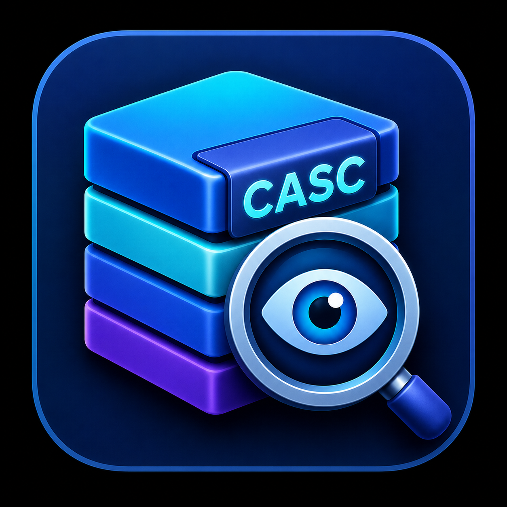
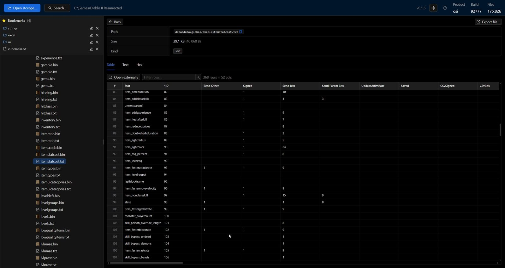
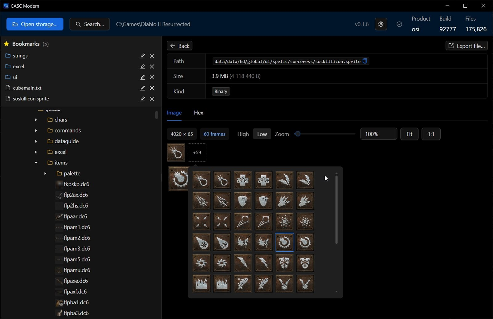
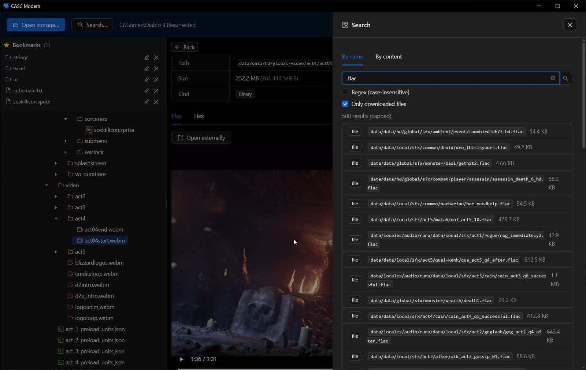

<div align="center">



# CASC Modern

[](LICENSE)
[](https://github.com/TrayHard/casc-modern/releases/latest)

</div>

A desktop browser and extractor for Blizzard CASC storages, focused on
Diablo II: Resurrected modding workflows, supposed to be an alternative to
[CascView](http://www.zezula.net/en/casc/main.html) with a modern
interface, dark theme, and additional features. Uses
[CascLib](https://github.com/ladislav-zezula/CascLib) as the underlying
engine, wrapped in a Tauri 2 frontend.

Contributions and issue reports are welcome.

## Screenshots







## Overview

CASC Modern reads any local CASC storage that CascLib can open. The current
build adds a lot tailored to D2R: decoders for `.sprite` (SpA1) and classic
`.dc6` graphics (with palette selection and per-frame image export), an image
viewer for `.tga`/`.bmp`/`.png`/`.jpg`, a sortable table viewer for the
Excel-style `.txt` data files, an inline player for `.flac` audio and `.webm`
video, syntax highlighting for the JSON and text formats used by D2R Toolbox
(`.model`, `.skeleton`, `.animations`, etc.), batch image export, and
full-text search over the indexed content.

## Features

- Tree and table browser of the storage with lazy-loaded folders, both
  virtualized so 175k-file storages stay smooth. Optional decoded thumbnails
  for image-like files in the tree and the directory table.
- Viewers selected per file kind:
  - `.sprite` (SpA1) — decoded to RGBA8, with zoom, a frame grid, and a
    High/Low quality toggle for files that ship a `.lowend` variant.
  - `.dc6` — classic indexed graphics, with a palette picker, frame
    stepping, and image export with format and quality controls.
  - `.tga`, `.bmp`, `.png`, `.jpg` — image viewer with zoom and fit.
  - Excel-style `.txt`/`.tsv` data — a sortable, filterable table with
    resizable, content-auto-sized columns.
  - `.flac`, `.webm`, and other browser-playable media — an inline player.
  - JSON, HTML, JS, CSS, Python, plain text — CodeMirror with syntax
    highlighting, fold gutter, and `Ctrl+F` search within the file.
  - Anything else — hex viewer.
- Search by file name (substring or regex) and by file content (with a
  glob filter and per-file size cap), with an option to skip files that
  aren't downloaded locally. Both stream results.
- Export of single files or whole directories, preserving the storage
  layout. Sprite and DC6 files can be exported as PNG; animated ones split
  into one PNG per frame.
- Bookmarks for paths you visit often, persisted across sessions.
- Settings: an importable format-icon theme, toggles for thumbnails and for
  hiding other-locale or low-quality (`.lowend`) variants, plus a Performance
  tab for the inline-JSON size limit and table overscan.
- Auto-update on installed builds: checks GitHub Releases, downloads and
  installs a signed MSI, then relaunches. Portable builds show a manual
  download link instead.

## Supported formats

Every file in the storage is readable as bytes; the table below lists the
extensions that get a viewer beyond hex.

| Extension                                                                                       | Viewer                                 |
| ----------------------------------------------------------------------------------------------- | -------------------------------------- |
| `.sprite`                                                                                       | SpA1 decoder — RGBA8 atlas + frames    |
| `.dc6`                                                                                          | Classic indexed graphics + palette     |
| `.tga`, `.bmp`, `.png`, `.jpg`                                                                  | Image viewer                           |
| `.txt`, `.tsv` (tab-separated)                                                                  | Sortable table                         |
| `.flac`, `.webm`, `.wav`, `.mp3`, `.ogg`, `.mp4`, …                                             | Audio/video player                     |
| `.json`, `.model`, `.skeleton`, `.animations`, `.particles`, `.physics`, `.cloth`, `.timelines` | JSON with pretty-printing              |
| `.html`, `.js`, `.css`, `.py`, and other text                                                   | CodeMirror — syntax highlight + search |
| anything else                                                                                   | Hex                                    |

The JSON/text/table viewers gate on a content sniff, so a binary file with a
text-ish extension (e.g. a binary `.particles`) still opens as hex.

Formats still shown as hex (PRs adding decoders welcome): `.dcc`, `.dt1`
(legacy D2 sprites), `.texture` and `.dds` (HD textures), `.tbl` (string
tables), `.cof` (animation defs).

## Install

Pre-built Windows binaries are on the
[Releases](https://github.com/TrayHard/casc-modern/releases/latest) page.

- **MSI installer** — enables in-app auto-update.
- **Portable `.exe`** — single file, no install required; updates must be
  downloaded manually.

The build is not Authenticode-signed, so Windows SmartScreen will warn on
first run. Choose "More info" → "Run anyway".

## Usage

Click **Open storage…** and pick the game install folder
(`C:\Program Files (x86)\Diablo II Resurrected` by default). CascLib walks
the directory looking for `.build.info` and the `Data/` layout; the storage
root or any subfolder works.

The last opened path is remembered and reopened automatically on the next
launch.

A `casc` CLI is also built (`crates/casc-cli`) with `info`, `list`,
`extract`, `extract-all`, and `cat` subcommands for scripting. Install it with
`cargo install --path crates/casc-cli`.

```bash
casc extract "D:/Games/Diablo II Resurrected" data/data/global/excel/skills.txt
casc extract-all "D:/Games/Diablo II Resurrected" -o out --filter excel/skills
```

`--tag` picks a named set of folders and files from `casc-tags.json` in the
current directory (override with `--tags-file`). The file maps each tag to a
list of paths, and a folder path covers everything under it:

```json
{ "strings": ["data/data/local/lng/strings"] }
```

Create this file for your own selection presets. The repository ignores it so
local project paths and workflows stay out of public commits.

`-m` reads a mod on top of the game: files in the mod win over their CASC
copies, and files only the mod has are included. `-m` alone uses the only mod
in `mods/`; `-m=NAME` and `-m=PATH` pick one (the value needs `=`).
`extract-all --flat` writes every file straight into `-o` under its lowercase
basename and refuses to overwrite on name clashes. For example:

```bash
casc extract-all "D:/Games/Diablo II Resurrected" --tag strings --flat -o out
```

`extract-all --convert FORMAT` (`png`, `webp`, `webp-lossless`, `jpeg` or
`avif`) writes every `.sprite` as images: one frame gives `name.webp`, more
give `name_0.webp`, `name_1.webp`, … by 0-based frame index (for skill icons,
the `IconCel` in `skilldesc.txt`). It skips `*.lowend.sprite` and legacy
`*.dc6` files and copies everything else unchanged. `--quality N` (0–100,
default 90) sets the quality of the lossy formats:

```bash
casc extract-all "D:/Games/Diablo II Resurrected" -m --filter hd/global/ui/spells --convert webp --flat -o icons
```

In the desktop app, use **Export as image…** on a `.sprite`, `.dc6`, PNG,
JPEG, BMP, or TGA file, **Export graphics here…** on a folder, or **Export
selected graphics…** after selecting multiple items. Choose PNG, WebP,
lossless WebP, JPEG, or AVIF. WebP, JPEG, and AVIF expose a 0–100% quality
control. JPEG replaces transparency with black.

## Build from source

Prerequisites on Windows:

- Rust stable (≥ 1.82) — install via [rustup](https://rustup.rs/).
- Node.js 20 LTS and npm.
- Visual Studio 2022 Build Tools with the "Desktop development with C++"
  workload (MSVC + Windows SDK). CascLib is built from vendored C++
  sources by the `cc` crate.
- WebView2 Runtime (pre-installed on Windows 11 and current Windows 10).

```sh
git clone https://github.com/TrayHard/casc-modern.git
cd casc-modern
npm install
npm run tdev          # development with hot reload
npm run tbuild        # release build → target/release/
```

Linux and macOS targets compile but have not been tested against a real
storage.

## Configuration

Settings are written to `%APPDATA%\com.casc-modern.app\settings.json`:

```json
{
  "last_storage_path": "C:\\Program Files (x86)\\Diablo II Resurrected",
  "last_export_dir": "D:\\d2r-extracted",
  "recent_storages": ["..."],
  "bookmarks": [
    { "name": "Excel", "path": "data/data/global/excel", "is_dir": true }
  ]
}
```

Removing the file resets all settings to defaults.

## Project layout

```
casc-modern/
├── crates/
│   ├── casclib-sys/    # FFI bindings to vendored CascLib
│   ├── casc-core/      # safe Rust API, format decoders (e.g. spa1)
│   └── casc-cli/       # `casc` command-line tool
├── src-tauri/          # Tauri 2 backend, IPC commands
├── src/                # React 18 + Vite frontend
└── vendor/CascLib/     # vendored CascLib source (MIT)
```

Notes on the SpA1 sprite format derived from sample files are in
[`crates/casc-core/src/formats/spa1.rs`](crates/casc-core/src/formats/spa1.rs).

## Contributing

Issues and pull requests are welcome. Before submitting:

- `npm run tcheck` for the TypeScript side.
- `cargo test -p casc-core` for the Rust side.
- Match the existing commit message style (`type(scope): summary`).

New format decoders should live in `crates/casc-core/src/formats/` and be
registered in `src/components/viewers/registry.ts`.

## Acknowledgements

- **Ladislav Zezula** for [CascLib](https://github.com/ladislav-zezula/CascLib),
  the MIT-licensed C++ library that this project links against. The
  original [CascView](http://www.zezula.net/en/casc/main.html) remains the
  reference implementation for browsing CASC storages.
- **Daedrohth** for [D2RSpriteConverter](https://github.com/Daedrohth/D2RSpriteConverter),
  which demonstrated that SpA1 is decodable.
- The [OpenDiablo2](https://github.com/OpenDiablo2) project, whose DC6 decoder
  was a reference for the `.dc6` format.
- The [Tauri](https://tauri.app), [React](https://react.dev),
  [Ant Design](https://ant.design), and [CodeMirror](https://codemirror.net)
  projects.

Full third-party notices: [NOTICE.md](NOTICE.md).

## License

MIT — see [LICENSE](LICENSE). Copyright © 2026 Poliakov Ilia (TrayHard).

---

This project is not affiliated with, endorsed by, or sponsored by Blizzard
Entertainment. Diablo® and Diablo® II: Resurrected are trademarks or registered
trademarks of Blizzard Entertainment, Inc. A legal copy of the game is required
to use this tool; the project itself ships no game assets. Screenshots in this
repository depict the tool operating on the user's own legally-obtained game
files and are shown for identification purposes only.
